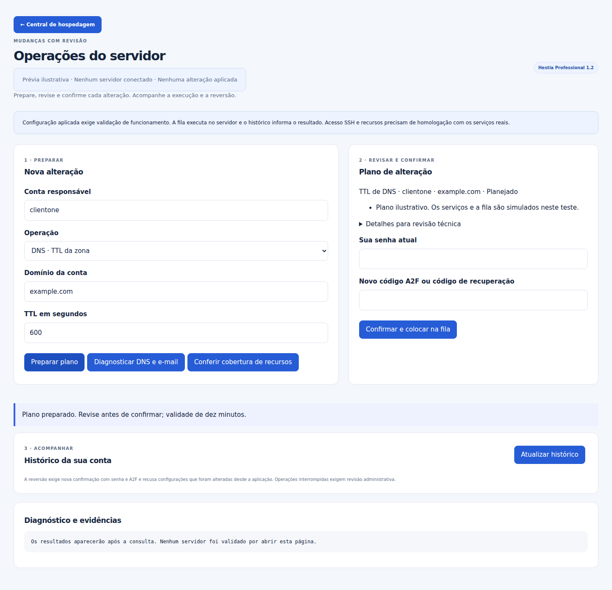

# Auditoria da camada Professional 1.2.0

Data: **25/10/2026**. Repositório: [sabas2025/hestia-cp](https://github.com/sabas2025/hestia-cp). Base recuperada: commit `456666dd46ad1f9d58f3dd4a4bfd85f31fcbc870`, Professional 1.1.1 sobre HestiaCP 1.10.5. A API oficial de releases continuava indicando Hestia 1.10.5 nesta consulta.

## Parecer e alcance

**As mudanças desta revisão foram implementadas e aprovadas nos testes locais descritos abaixo. A entrega empresarial é parcial; não houve conexão SSH autenticada, implantação nem homologação na VPS.** A revisão cobre código, limites de autorização, recuperação de falhas, dependências e interface. Não é certificação, pentest completo, varredura de pacotes do servidor ou atestado de equivalência com cPanel.

A continuação anterior perdeu arquivos temporários durante a manutenção do ambiente. A versão publicada 1.1.1 foi recuperada e a implementação desta entrega foi reconstruída e testada novamente. Funcionalidades não presentes nesta árvore não são contabilizadas a partir de testes ou descrições anteriores.

Revisão funcional publicada: [`80f72f54ed85ce47924167d4444e288cc79b36ad`](https://github.com/sabas2025/hestia-cp/commit/80f72f54ed85ce47924167d4444e288cc79b36ad), árvore `a5dc51556fa9c4f46a7399aabf606191b837e5b9`. O [CI dessa revisão](https://github.com/sabas2025/hestia-cp/actions/runs/40168581919) terminou com **success**, job `121094597449`, incluindo testes obrigatórios, advisories, build e documentação. O [fechamento em JSON](professional/test-results/final-audit-1.2.0.json) registra a conferência independente: **1.695 blobs e modos Git correspondentes, 1.694 checksums corretos; nenhuma divergência antes ou depois da repetição da suíte sobre o ZIP baixado**. A [execução do download](professional/test-results/verification-downloaded-1.2.0.json) passou novamente com 127 testes e 33 grupos. Este fechamento acrescenta documentação/evidências/checksums, sem alterar os executáveis da revisão funcional.

## Mudanças verificadas e prioridade

| Prioridade | Mudança aplicada no código                    | Evidência e limite                                                                                                                                                                                                                                     |
| ---------- | --------------------------------------------- | ------------------------------------------------------------------------------------------------------------------------------------------------------------------------------------------------------------------------------------------------------ |
| P1         | Nova GUI de planos de operação                | Controller real testado com bootstrap nativo representado por fixture; titular, papel atual, suspensão, login desabilitado, versão, CSRF, modo somente leitura e métodos HTTP. Não substitui login real na VPS.                                        |
| P1         | Autorização por domínio e delegação limitada  | Root revalida conta e propriedade. Usuário delegado atua somente na própria conta; SSH/recursos ficam para admin. Revogação impede execução já enfileirada.                                                                                            |
| P1         | Senha e A2F antes da fila                     | Reautenticação reutiliza o backend MFA corrigido; teste integra TOTP real e rejeita reutilização. Nenhuma senha ou OTP entra no argv ou plano salvo.                                                                                                   |
| P1         | Plano com validade e controle de concorrência | Dez minutos, snapshots SHA-256/modo, comandos fixos, parâmetros limitados e recusa de deriva. Mudanças externas ao módulo não compartilham seu lock.                                                                                                   |
| P1         | Execução fora do timeout HTTP                 | Tarefa transitória systemd com ticket privado, nonce, prazo de início, limite de execução e revalidação. Orquestração testada por simulação; PID1/systemd de uma VPS não foi exercitado.                                                               |
| P1         | Reversão e falhas explícitas                  | Retorna configuração anterior em erros testados; reversão manual com nova A2F recusa alterações posteriores. Falha na recuperação registra `recovery-required`. Interrupção/energia pode exigir intervenção, sem promessa ACID sobre o core.           |
| P1         | Cache opcional de conteúdo público            | HTTP/TLS validados pelo Nginx real; pool por domínio e hook de rebuild, extensões preservadas, bypass de sessão/autorização/query/rotas sensíveis, exclusão de Set-Cookie. Sem ensaio de tráfego ou prova de ausência de conteúdo privado em produção. |
| P1         | Políticas SSH com validação efetiva           | OpenSSH real validou sintaxe e valores de keys-only, sftp-only e disabled, sem listener. Template protege administrador de recuperação e exige chave revisada para retirar senha. SFTP sem chroot e login remoto não testado.                          |
| P1         | Novos advisories nas ferramentas corrigidos   | Vite 6.4.3 → 6.4.5; Vitest e mocker 4.1.11 → 4.1.12. Locks, build e testes de documentação revalidados. Não altera pacotes da VPS.                                                                                                                     |
| P2         | Diagnóstico DNS/e-mail e TTL                  | Doze consultas limitadas e escopo da zona. Sinaliza SPF/DMARC/MX/NS/DS. Presença de DS/DNSKEY não é validação da cadeia DNSSEC; faltam testes autoritativos, PTR e entrega real.                                                                       |
| P2         | Limite padrão de envio                        | Comando nativo, valores limitados e reversão do valor `system` preservada. Limite por caixa postal, com exceções individuais, não agregado por domínio.                                                                                                |
| P2         | Memória/processos/I/O                         | Arquivo próprio na slice do UID, sem sobrescrever CPUQuota/MemoryHigh nativos. Diagnóstico detecta PHP fora da slice. Eficácia em processos atuais/futuros e carga não demonstrada.                                                                    |
| P2         | Chave SSH com prazo                           | Valida chave pública real, prazo, CIDR, duplicação e preservação das outras linhas. Não gera ou transfere chaves privadas; não cria bastion/CA/chroot.                                                                                                 |
| P2         | Política append_only                          | Os dois motores de backup recusam retenção/prune antes de comandos. Não equivale a WORM/Object Lock remoto nem retira privilégios de exclusão das credenciais.                                                                                         |
| P2         | Instalação e manutenção                       | Templates divergentes são recusados antes de mutações, arquivos novos entram no manifesto e log privado tem rotação. Bloqueio/quarentena do File Manager da 1.1.1 permanecem.                                                                          |

## Resultados locais reproduzidos

| Verificação                                    | Resultado                                                                                                            |
| ---------------------------------------------- | -------------------------------------------------------------------------------------------------------------------- |
| Suíte de release                               | **127 testes Python; zero falhas, erros ou skips; 33 grupos aprovados**                                              |
| Asserções PHP de autorização/dados             | 34 aprovadas; novos testes executam também o controller de operações                                                 |
| Sintaxe de toda a árvore de fontes             | 333 PHP e 681 scripts Bash sem erro                                                                                  |
| Nginx                                          | Templates HTTP e TLS renderizados e `nginx -t` aprovado; nenhum worker iniciado                                      |
| OpenSSH                                        | Três políticas geradas, parsing e valores efetivos aprovados; nenhuma porta aberta                                   |
| Navegador                                      | Central, A2F e operações em 360, 768 e 1440 pixels; sem overflow/erros JS; API/fila/serviços simulados nas operações |
| Build JS/CSS                                   | Aprovado após corrigir dependências                                                                                  |
| Documentação                                   | Oito testes e build aprovados                                                                                        |
| Controle negativo sem ferramentas/dependências | Retorno 1 e `incomplete-or-failed`; ausência de ferramentas, falhas e skips foram detectados, sem falsa aprovação    |
| OSV dos locks atuais                           | 595 versões únicas consultadas; zero achados em componentes ativos; dois componentes opcionais bloqueados com avisos |
| npm audit do lock raiz atualizado              | Zero avisos de todas as severidades                                                                                  |
| Infraestrutura real                            | Não acessada, modificada ou homologada                                                                               |

Evidências: [suíte completa](professional/test-results/verification-1.2.0.json), [controle negativo](professional/test-results/negative-release-1.2.0.json), [navegador de operações](professional/test-results/browser-operations-1.2.0.json), [build e dependências](professional/test-results/build-dependencies-1.2.0.json), [consulta OSV](professional/test-results/advisories-1.2.0.json) e [inventário dos locks](professional/test-results/dependencies-1.2.0.json). As verificações locais usam ferramentas extraídas isoladamente, fixtures e contas sintéticas; o instalador completo não foi executado.

O controle negativo realizou os mesmos 127 testes com dependências ausentes: três falhas, onze erros e catorze skips. Esse resultado é deliberadamente reprovado e não entra no resultado aprovado da execução completa.

### Dependências bloqueadas e dívida residual

A consulta atual identificou `GHSA-cxf4-7mrp-vvpr` em `league/flysystem` 1.1.10 e `GHSA-q97c-8qh3-fpc6` em `phpseclib/phpseclib` 2.0.55 no File Manager opcional bloqueado. Esses pacotes não foram declarados corrigidos; a interface e a instalação continuam bloqueadas. A migração desse componente exige adaptação e testes próprios, preservando dados existentes.

A consulta de uma base de advisories não garante ausência de vulnerabilidades desconhecidas. O inventário é dos locks e assets do código; não lista versões efetivamente instaladas de sistema operacional, imagens Docker ou bibliotecas da VPS. A verificação remota do CI inclui os checks de Composer/npm já existentes e os novos testes/build; seu resultado exato pertence ao fechamento.

## Pedidos ainda incompletos

O [guia 1.2](EMPRESARIAL-1.2.md#limites-da-entrega-e-próximos-módulos) contém a matriz completa. Permanecem sem entrega integral: passkeys/SSO e RBAC amplo; DNS redundante e DNSSEC homologados; migração/quarentena de e-mail; alertas externos e métricas; laboratório de importação SQL, incrementais avançados e imutabilidade externa; staging/deploy GitHub/rollback de aplicações; Redis/OPcache gráficos; limite rígido de todos os processos da conta; OpenLiteSpeed; antivírus de sites em tempo real com GUI; Docker/Compose e NoSQL gráficos completos; replicação, HA, balanceamento e failover; assinatura/proveniência e Tamper-proof Enterprise; ativação/desativação geral de todos os módulos pela interface.

As integrações opcionais de editor/Portainer/listmonk e os geradores Node/proxy/Compose da revisão anterior não foram instalados na infraestrutura. WAF/Fail2Ban publicados não demonstram cobertura de Nginx direto, Docker, Node ou porta do painel.

## Critérios de aceite restantes

1. **P1:** instalar em homologação suportada, aplicar a camada de uma origem independente e verificar atualização, deriva e recuperação por console. Não rodar instalador completo sobre um painel existente.
2. **P1:** testar login/A2F/recuperação real e acesso SSH novo; confirmar conta desativada, delegação revogada, fila systemd e rollback de serviço falho.
3. **P1:** restaurar sites e SQL em homologação, testar todos os provedores configurados e medir RPO/RTO; comprovar retenção remota com identidade separada.
4. **P1:** testar isolamento de cache entre sessões, endpoints sensíveis e respostas de origem; confirmar WAF/banimento, exceções e cobertura de cada serviço.
5. **P2:** medir limites reais de PHP/Docker/Node por conta e implantar monitoramento/alertas. Entregar os demais módulos por critérios de autorização, falha, recuperação e operação comprovada.

## Capturas

Renderizações da interface do código com dados ilustrativos e serviços simulados; **não são capturas de uma VPS atualizada**.

[Abrir captura para celular](docs/screenshots/1.2/business-360.png).
