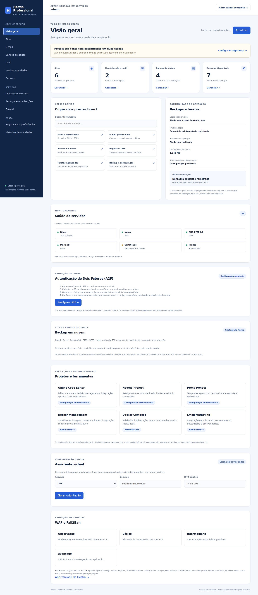
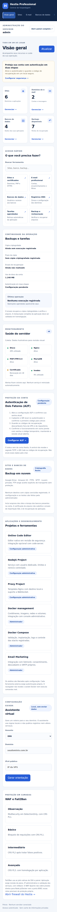

> Professional **1.2.0 — entrega parcial de operações empresariais (25/10/2026)**. Base HestiaCP 1.10.5. Consulte o [guia e os limites](EMPRESARIAL-1.2.md) e a [auditoria atual](AUDITORIA-1.2.md). Inclui GUI de operações, revisão com senha/A2F, fila, reversão, diagnóstico DNS/e-mail, cache público, políticas SSH e configuração de recursos. **Não foi implantado nem homologado na VPS; os demais módulos empresariais continuam pendentes.**

>
> Para conexão de diagnóstico à VPS como root na porta 22, siga [CONEXAO-SSH.md](CONEXAO-SSH.md). Publicar este código no GitHub não instala o painel na VPS.
>
> Os workflows originais foram preservados em `docs/upstream-workflows/` como referência. O diagnóstico SSH manual depende dos Secrets descritos no guia. O workflow Professional release checks executa testes e consultas de advisories, sem acesso à VPS.

## Correções 1.1.1

Veja a [auditoria final da versão publicada](AUDITORIA-FINAL-1.1.1.md): correções verificadas, CI aprovado, evidências e funcionalidades ainda pendentes. Nenhuma implantação na VPS foi executada.

Consulte [as correções e mudanças de operação](CORRECOES-1.1.1.md), especialmente a recuperação de A2F e a quarentena do File Manager. As validações locais não substituem a homologação de serviços na VPS.

## Novidades da camada 1.1

- **A2F:** preparação e confirmação na conta titular, QR local, senha/fator nas alterações e recuperação descartável.
- **Backups multicloud:** cópia criptografada para Google Drive, Amazon S3, FTPS, FTP com aceite explícito, SFTP e nuvem privada; arquivo nativo com sites e dumps dos bancos, verificação e recuperação isolada.
- **Assistente virtual local:** roteiros de servidor, DNS, e-mail, backup e proteção, sem publicar configurações automaticamente.
- **WAF e Fail2Ban:** perfis de observação a avançado, validação e rollback; cobertura automática limitada ao Apache e às jails nativas.
- **Projetos:** integrações opcionais com code-server/Portainer/listmonk, CLI Docker/Compose/Node e proxy. File Manager legado bloqueado até revisão das dependências.

Guias: [auditoria e pendências](AUDITORIA-1.1.md) · [backup em nuvem](BACKUPS-NUVEM.md) · [A2F/WAF/Fail2Ban](SEGURANCA-A2F-WAF.md) · [projetos e ferramentas](PROJETOS-PLATAFORMA.md).

**Estado:** código e testes locais; nenhum desses serviços foi ativado na VPS do proprietário. Integrações externas exigem instalação, credenciais, autenticação e homologação. Os cartões da central informam essa necessidade e não simulam serviços instalados.

**Auditoria anterior:** a [verificação da revisão 1.1](AUDITORIA-VERIFICACAO-2026-10-19.md) registrou as falhas que motivaram a camada [1.1.1](CORRECOES-1.1.1.md). Os recursos empresariais adicionais continuam fora da entrega completa.



<h1 align="center"><a href="https://www.hestiacp.com/">Hestia Control Panel</a></h1>

## Prévia da nova interface

Capturas com dados ilustrativos, sem conexão com a VPS. Consulte [os detalhes dos prints](docs/screenshots/README.md).

### Computador


<details>
<summary>Ver versão para celular</summary>



</details>

<h2 align="center">Lightweight and powerful control panel for the modern web</h2>

<p align="center"><strong>Base desta camada:</strong> Version 1.10.5 | <a href="https://github.com/hestiacp/hestiacp/blob/release/CHANGELOG.md">View Changelog</a></p>

<p align="center">
	<a href="https://www.hestiacp.com/">HestiaCP.com</a> |
	<a href="https://docs.hestiacp.com/">Documentation</a> |
	<a href="https://forum.hestiacp.com/">Forum</a>
	<br/><br/>
	<a href="https://github.com/hestiacp/hestiacp/actions/workflows/lint.yml">
		
	</a>
	<a href="https://gurubase.io/g/hestia">
		
	</a>
</p>

## **Welcome!**

Hestia Control Panel is designed to provide administrators an easy to use web and command line interface, enabling them to quickly deploy and manage web domains, mail accounts, DNS zones, and databases from one central dashboard without the hassle of manually deploying and configuring individual components or services.

## Donate

[](https://www.paypal.com/cgi-bin/webscr?cmd=_s-xclick&hosted_button_id=ST87LQH2CHGLA)<br /><br />
Bitcoin : bc1q48jt5wg5jaj8g9zy7c3j03cv57j2m2u5anlutu<br>
Ethereum : 0xfF3Dd2c889bd0Ff73d8085B84A314FC7c88e5D51<br>
Binance: bnb1l4ywvw5ejfmsgjdcx8jn5lxj7zsun8ktfu7rh8<br>
Smart Chain: 0xfF3Dd2c889bd0Ff73d8085B84A314FC7c88e5D51<br>

Project infrastructure is partly provided by [infrahost](https://infrahost.ch/en/).

## Features and Services

- Apache2 and NGINX with PHP-FPM
- PHP 8.4 as the default for this modified installer; see [PROFISSIONAL.md](PROFISSIONAL.md) for the supported selection.
- DNS Server (Bind) with clustering capabilities
- POP/IMAP/SMTP mail services with Anti-Virus, Anti-Spam, and Webmail (ClamAV, SpamAssassin, Sieve, Roundcube)
- MariaDB/MySQL and/or PostgreSQL databases
- Let's Encrypt SSL support with wildcard certificates
- Firewall with brute-force attack detection and IP lists (iptables, fail2ban, and ipset).

## Supported platforms and operating systems

- **Debian:** 13, 12
- **Ubuntu:** 26.04 LTS, 24.04 LTS, 22.04 LTS

**NOTES:**

- Hestia Control Panel does not support 32 bit operating systems!
- Hestia Control Panel in combination with OpenVZ 7 or lower might have issues with DNS and/or firewall. If you use a Virtual Private Server we strongly advice you to use something based on KVM or LXC!

## Installing Hestia Control Panel

- **NOTE:** You must install Hestia Control Panel on top of a fresh operating system installation to ensure proper functionality.

While we have taken every effort to make the installation process and the control panel interface as friendly as possible (even for new users), it is assumed that you will have some prior knowledge and understanding in the basics how to set up a Linux server before continuing.

### Step 1: Log in

To start the installation, you will need to be logged in as **root** or a user with super-user privileges. You can perform the installation either directly from the command line console or remotely via SSH:

```bash
ssh root@your.server
```

### Step 2: Download this repository

Download the complete source tree, including the shared installer and dependency lock:

```bash
git clone https://github.com/sabas2025/hestia-cp.git
cd hestia-cp
sha256sum -c SHA256SUMS
```

### Step 3: Inspect before installing

```bash
bash install/hst-install.sh --preflight
```

The inspection does not install the panel. Installation requires a fresh supported OS and explicit `--apply`:

```bash
bash install/hst-install.sh --apply
```

Read [PROFISSIONAL.md](PROFISSIONAL.md) before installation, including the existing-panel checks, authentication, backup setup and operational validation still required. Do not use the official single-file download to obtain the modifications in this repository.

## How to upgrade an existing installation

Automatic Updates are enabled by default on new installations of Hestia Control Panel and can be managed from **Server Settings > Updates**. To manually check for and install available updates, use the apt package manager:

```bash
apt-get update
apt-get upgrade
```

## Issues & Support Requests

- If you encounter a general problem while using Hestia Control Panel and need help, please [visit our forum](https://forum.hestiacp.com/) to search for potential solutions or post a new thread where community members can assist.
- Bugs and other reproducible issues should be filed via GitHub by [creating a new issue report](https://github.com/hestiacp/hestiacp/issues) so that our developers can investigate further. Please note that requests for support will be redirected to our forum.

**IMPORTANT: We _cannot_ provide support for requests that do not describe the troubleshooting steps that have already been performed, or for third-party applications not related to Hestia Control Panel (such as WordPress). Please make sure that you include as much information as possible in your forum posts or issue reports!**

## Contributions

If you would like to contribute to the project, please [read our Contribution Guidelines](https://github.com/hestiacp/hestiacp/blob/release/CONTRIBUTING.md) for a brief overview of our development process and standards.

## Copyright

"Hestia Control Panel", "HestiaCP", and the Hestia logo are original copyright of hestiacp.com and the following restrictions apply:

**You are allowed to:**

- use the names "Hestia Control Panel", "HestiaCP", or the Hestia logo in any context directly related to the application or the project. This includes the application itself, local communities and news or blog posts.

**You are not allowed to:**

- sell or redistribute the application under the name "Hestia Control Panel", "HestiaCP", or similar derivatives, including the use of the Hestia logo in any brand or marketing materials related to revenue generating activities,
- use the names "Hestia Control Panel", "HestiaCP", or the Hestia logo in any context that is not related to the project,
- alter the name "Hestia Control Panel", "HestiaCP", or the Hestia logo in any way.

## License

Hestia Control Panel is licensed under [GPL v3](https://github.com/hestiacp/hestiacp/blob/release/LICENSE) license, and is based on the [VestaCP](https://vestacp.com/) project.<br>
